<p align="center">
  <sub>Passer le spectacle : <a href="#installation">Installer</a> · <a href="#koeki-it-support">Le manuel</a> · <a href="README.md">English version</a></sub>
</p>

<p align="center">
  
</p>

<p align="center">
  
</p>

<p align="center">
  
</p>

<p align="center">
  
</p>

<p align="center">
  
</p>

<p align="center">
  
</p>

<p align="center">
  
</p>

<p align="center">
  
</p>

<p align="center">
  
</p>

<p align="center">
  
</p>

<p align="center">
  
</p>

<p align="center">
  
</p>

<p align="center">
  
</p>

<p align="center">
  
</p>

<p align="center">
  <a href="https://github.com/agencekoeki/koeki-it-support/releases/latest"></a>
  <a href="LICENSE"></a>
  <a href="https://agentskills.io"></a>
  
  
  
</p>

<p align="center">
  <a href="#installation"><b>Installer</b></a> ·
  <a href="#ce-que-fait-le-skill">Fonctionnement</a> ·
  <a href="#exemple">Exemple</a> ·
  <a href="koeki-it-support/SKILL.md">Lire le skill</a> ·
  <a href="README.md">English version</a>
</p>

# koeki-it-support

*Le manuel. Tout ce qui précède, en texte : pour les personnes qui lisent les manuels, et pour les machines.*

**Le support informatique qui passe à la maison.** Un skill (au format Agent Skills) qui fait de Claude un technicien soigneux pour votre propre PC sous Windows 10 ou 11. Il raisonne comme un technicien de terrain expérimenté, vous demande la permission avant chaque changement et vous laisse un journal écrit de tout ce qu'il a fait.

> **État : v0.1.** Le skill s'appuie sur la littérature du dépannage et sur la documentation de Microsoft. Il n'a pas encore été validé par des techniciens de terrain. Si vous en êtes un, [vos cas nous intéressent](CONTRIBUTING.md#en-français).

## Ce qu'il va vous dire

Oui, il vous demandera si vous avez redémarré. Un vrai **Redémarrer**, pas **Arrêter** : avec le démarrage rapide, Windows ne fait pas la même chose dans les deux cas. Ce qui le distingue, c'est ce qu'il fait après le redémarrage.

| Vous | Lui |
|---|---|
| « Si j'ai essayé de redémarrer ? Évidemment. » | « Arrêter, ou Redémarrer ? Faisons un vrai Redémarrer. Je patiente. » |
| « Réparez tout d'un coup, qu'on en finisse. » | « Non. Un changement à la fois, sinon on ne saura jamais lequel a marché. » |
| « J'ai trouvé un optimiseur de PC gratuit. » | « Reposez-le, s'il vous plaît. » Puis l'outil déjà intégré à Windows qui fait le travail. |
| « Defender me gêne. Coupez-le. » | « Non. » Une phrase pour dire pourquoi, et une solution sans risque. |
| « Une fenêtre me dit d'appeler Microsoft à ce numéro. » | « Ce n'est pas Microsoft. Leurs messages ne contiennent jamais de numéro de téléphone. » |
| « Ça a l'air plus rapide, je crois. » | « On ne fait pas dans le "je crois". On redémarre, on remesure, et ensuite je l'écris au journal. » |

Ces répliques sont là pour illustrer, ce ne sont pas des transcriptions : le skill est plus poli, et tout aussi têtu. Le comportement derrière chacune est écrit noir sur blanc dans [le skill](koeki-it-support/SKILL.md).

## D'où vient ce skill

Un PC fixe affichait « Connecté », mais aucune page ne s'ouvrait. Le portable posé à côté, lui, fonctionnait.

Trois causes s'empilaient :

1. **Une adresse IP saisie à la main, sans passerelle.** Le PC ne savait pas où envoyer son trafic.
2. **Le filtre web d'une suite de sécurité tierce.** Il bloquait le DNS et le web, mais laissait passer le ping : le réseau avait l'air à moitié vivant.
3. **Un serveur DNS auto-hébergé, tombé en panne des mois plus tôt.** Personne ne s'en était aperçu : tous les appareils se rabattaient en silence sur le DNS IPv6 de la box, qui masquait la panne.

Corriger la passerelle n'a pas ramené le web. Retirer le filtre, si. Mais il a fallu interroger chaque serveur DNS, un par un, pour découvrir la troisième panne, restée muette. En médecine, on appelle cela le dictum de Hickam : un patient peut avoir plusieurs maladies à la fois. Un outil qui s'arrête à la première cause plausible aurait crié victoire trop tôt. Un script qui « réinitialise tout » aurait effacé les indices.

C'est le métier de ce skill : regarder avant de toucher, changer une seule chose à la fois, remesurer après chaque correctif, et continuer jusqu'à ce que le symptôme de départ ait vraiment disparu.

Ce qui le distingue :

- **Il raisonne au lieu d'enchaîner des commandes.** Il pense comme un technicien, en s'appuyant sur les règles de débogage d'Agans, le chapitre dépannage du livre SRE de Google, la méthode USE de Brendan Gregg, l'analyse « est / n'est pas » de Kepner-Tregoe et les enquêtes de Mark Russinovich.
- **Il demande votre accord avant chaque changement**, selon quatre niveaux de risque.
- **Il crée un point de restauration avant la première modification**, vérifie qu'il existe bel et bien, et tient un journal.
- **Il refuse les pratiques à risque** : nettoyeurs de registre, scripts de « debloat », désactivation de Microsoft Defender.
- **Il parle votre langue**, avec des mots simples, à des personnes qui ne sont pas techniciennes.

## Ce que fait le skill

Il commence par nommer la mission, parce que la réussite ne se mesure pas de la même façon :

| Mission | Situation type | La réussite, c'est |
|---|---|---|
| **Réparer** | Quelque chose qui marchait ne marche plus | Le symptôme a disparu, vérifié après un redémarrage |
| **Remettre en forme** | Un PC qui fonctionne mais paraît lent | Un gain mesuré sur les deux ou trois actions qui comptent pour vous |
| **Seconde vie** | Un PC ancien, lent ou plus pris en charge | Une décision réfléchie : réparer, améliorer, réaffecter, remplacer ou recycler |

### La boucle de raisonnement

Les étapes 0 à 4 ne modifient rien sur votre PC.

0. **Trier.** Des données sont-elles en danger ? Alors on sauvegarde d'abord, avant tout le reste.
1. **Énoncer le problème.** Lent à quel point, depuis quand, sur quel appareil ? Qu'est-ce qui est touché, et qu'est-ce qui pourrait l'être mais ne l'est pas ?
2. **Chercher ce qui a changé** depuis que ça marchait : votre récit d'abord, puis les preuves (Moniteur de fiabilité, dates d'installation, mises à jour).
3. **Les gestes gratuits, avec votre accord :** un vrai redémarrage, un autre appareil, un câble.
4. **Observer pendant que le symptôme se produit :** un tour des ressources pour la lenteur, une échelle couche par couche pour le réseau.
5. **Classer les hypothèses :** le probable, le peu coûteux et le sans risque d'abord. Les causes fréquentes avant les causes exotiques, sans oublier que plusieurs causes peuvent s'additionner.
6. **Tester une hypothèse à la fois :** un changement réversible, mesuré avant et après, accepté, consigné. Annulé aussitôt s'il n'a servi à rien.
7. **Vérifier** après un redémarrage, dans les mêmes conditions. Jamais à l'impression.
8. **Remettre le journal :** ce qui a changé, comment revenir en arrière, ce qu'on a appris.

Après trois correctifs ratés, il s'arrête et en parle avec vous. Quand il trouve une première cause, il remesure le symptôme de départ. Il passe la main à un technicien humain pour les pannes matérielles, le BIOS et la récupération de données.

### Quatre niveaux d'accord

| Niveau | Exemples | Ce que le skill exige |
|---|---|---|
| **0. Lecture** | Réglages réseau, journaux d'événements, santé du disque | Il dit ce qu'il lit et pourquoi. Il n'affiche jamais de secret (clé Wi-Fi, clé de produit, clé BitLocker). |
| **1. Réversible, sans droits administrateur** | Désactiver une application au démarrage, mettre en pause la synchronisation | Votre accord explicite pour cette action, un point de restauration avant le premier changement, une ligne au journal. |
| **2. Système** | Désinstaller un logiciel, changer un pilote ou un service, démarrage minimal | Un point de restauration vérifié, la commande exacte montrée et expliquée, votre accord. C'est vous qui la lancez en administrateur : le skill ne s'élève jamais lui-même. |
| **3. Lourd** | Réinitialisation réseau, restauration du système, réinitialisation du PC, BIOS, matériel | Une sauvegarde vérifiée, votre clé de récupération BitLocker en main, le PC sur secteur, la proposition d'un technicien humain, et votre accord à chaque étape. |

L'accord se donne action par action, jamais en bloc. Demandez-lui de « tout faire d'un coup » : il vous expliquera pourquoi il ne le fera pas. Quand plusieurs changements arrivent ensemble, personne ne peut dire lequel a aidé, ni lequel a cassé quelque chose.

### Ce qu'il refuse

Il ne lance pas de script distant dans PowerShell. Il n'installe ni nettoyeur de registre, ni « optimiseur de PC », ni logiciel tiers de mise à jour des pilotes. Il n'applique ni script de « debloat » ni pack de réglages. Il ne coupe ni Windows Update, ni Microsoft Defender, ni le pare-feu, ni le contrôle de compte d'utilisateur. Il n'ajoute pas d'exception à l'antivirus parce qu'un outil le réclame. Il ne lance pas d'opération lourde sur un disque qui faiblit avant une sauvegarde. Il n'ouvre pas d'accès à distance à quelqu'un que vous n'avez pas contacté vous-même. À chaque refus, il explique pourquoi en une phrase et propose l'outil intégré à Windows qui fait le travail sans risque. Il repère aussi les arnaques au faux support : les messages de Microsoft ne contiennent jamais de numéro de téléphone.

Le skill tient en un seul fichier Markdown, sans aucun script. Lisez-le avant de l'installer, comme tout skill : [koeki-it-support/SKILL.md](koeki-it-support/SKILL.md). Il est écrit en anglais, mais il vous répond dans votre langue.

## Installation

### En plugin (reste à jour)

Ce dépôt est aussi une marketplace de plugins : Claude peut le suivre, et vous n'avez pas à retélécharger un zip à chaque version.

Les intitulés ci-dessous sont ceux de l'interface en anglais ; ils peuvent être traduits dans la vôtre.

**Claude (claude.ai et l'application de bureau)**

1. Ouvrez **Customize > Plugins**, puis **Add > Add marketplace > Add from a repository**.
2. Saisissez `agencekoeki/koeki-it-support`, laissez **Sync automatically** activé, puis choisissez **Sync**.
3. Choisissez **Add** à côté de **Koeki IT Support**.

Avec **Sync automatically**, le plugin est tenu à jour quand ce dépôt change. Il est enregistré sur votre compte : il est donc aussi disponible dans Cowork et Claude Code.

Source : [Plugins](https://claude.com/docs/plugins/overview), documentation de Claude.

**Claude Code**

```
/plugin marketplace add agencekoeki/koeki-it-support
/plugin install koeki-it-support@koeki
```

Décrivez ensuite votre problème, ou tapez `/koeki-it-support:koeki-it-support`.

Le plugin suit les commits de ce dépôt. Pour le mettre à jour, ouvrez `/plugin`, allez dans **Marketplaces**, choisissez **koeki**, puis **Update marketplace**. Sur le même écran, **Enable auto-update** laisse Claude Code le faire pour vous (désactivé par défaut pour les marketplaces qui ne sont pas celles d'Anthropic).

Source : [Install and manage plugins](https://code.claude.com/docs/en/plugins/install), documentation de Claude Code.

### En skill, depuis le zip (claude.ai et l'application de bureau)

Téléchargez `koeki-it-support.zip` depuis la [dernière version publiée](https://github.com/agencekoeki/koeki-it-support/releases/latest). Il contient le dossier `koeki-it-support/` et son `SKILL.md`.

1. Vérifiez que l'exécution de code est activée : **Settings > Capabilities > Code execution and file creation**. Sur les offres Team et Enterprise, c'est un propriétaire de l'organisation qui la gère.
2. Ouvrez **Customize > Skills**, cliquez sur **+**, puis **Create skill > Upload a skill**.
3. Choisissez `koeki-it-support.zip`, puis activez le skill.

Les skills personnalisés sont disponibles sur les offres Free, Pro, Max, Team et Enterprise. Dans une conversation classique, Claude n'a pas accès à votre PC : il vous donne une commande à la fois, vous dit où la lancer, et lit le résultat que vous lui collez.

Source : [Use skills in Claude](https://support.claude.com/en/articles/12512180-use-skills-in-claude), centre d'aide de Claude.

### En skill, à la main (Claude Code)

Copiez le dossier `koeki-it-support` (celui qui contient `SKILL.md`) dans `~/.claude/skills/` pour l'utiliser dans tous vos projets, ou dans le dossier `.claude/skills/` d'un projet.

Sous macOS, Linux ou Git Bash :

```bash
git clone https://github.com/agencekoeki/koeki-it-support.git
mkdir -p ~/.claude/skills
cp -r koeki-it-support/koeki-it-support ~/.claude/skills/
```

Sous Windows, dans PowerShell :

```powershell
git clone https://github.com/agencekoeki/koeki-it-support.git
New-Item -ItemType Directory -Force "$HOME\.claude\skills" | Out-Null
Copy-Item -Recurse .\koeki-it-support\koeki-it-support "$HOME\.claude\skills\"
```

Claude Code prend le skill en compte sans redémarrage. Si le dossier des skills n'existait pas au début de votre session, lancez `/reload-skills`. Décrivez ensuite votre problème, ou tapez `/koeki-it-support`. Quand Claude Code tourne sur le PC Windows lui-même, le skill lance seul les commandes de lecture et vous confie tout ce qui demande les droits administrateur.

Source : [Extend Claude with skills](https://code.claude.com/docs/en/skills), documentation de Claude Code.

### Autres outils

koeki-it-support suit le format ouvert [Agent Skills](https://agentskills.io), reconnu par de nombreux agents. La liste des outils compatibles et leurs instructions d'installation sont sur [agentskills.io](https://agentskills.io), avec la [spécification](https://agentskills.io/specification).

## Exemple

Un échange pour illustrer, raccourci. Le nom du logiciel est inventé.

> **Vous :** Mon PC met trois minutes à démarrer depuis la semaine dernière.
>
> **Claude :** Cherchons ce qui a changé. Trois minutes jusqu'à l'écran de connexion, ou jusqu'au moment où vous pouvez vraiment travailler ? Avez-vous installé ou mis à jour quelque chose la semaine dernière ? En attendant, j'aimerais lire le journal de démarrage de Windows. Cela ne modifie rien. Lancez cette commande dans Windows PowerShell ouvert en administrateur, puis collez-moi le résultat. *(une commande en lecture seule)*
>
> **Vous :** *(colle le résultat)*
>
> **Claude :** Vos démarrages sont passés d'environ 40 secondes à environ 170 depuis mardi, et Windows lui-même accuse un utilitaire de mise à jour du fabricant, installé ce jour-là, d'environ 90 secondes de retard. C'est ma première hypothèse ; rien d'autre n'est écarté pour l'instant. Avant tout changement, créons un point de restauration et vérifions qu'il existe bien.
>
> **Claude :** Étape suivante, si vous êtes d'accord : désactiver « VendorUpdateHelper » dans Gestionnaire des tâches > Applications de démarrage. C'est réversible et rien n'est désinstallé. Je vous guide ?
>
> **Vous :** Oui.
>
> **Claude :** C'est fait. Faites maintenant un vrai **Redémarrer** (pas Arrêter), puis relancez la même commande.
>
> **Vous :** *(42 secondes)*
>
> **Claude :** Retour à la normale, mesuré après un vrai redémarrage. Voici votre journal.

| Heure | Changement | Effet mesuré | Pour revenir en arrière |
|---|---|---|---|
| 10 h 42 | Point de restauration « Before IT support changes », vérifié dans la liste | — | — |
| 10 h 47 | « VendorUpdateHelper » désactivé dans Gestionnaire des tâches > Applications de démarrage | Démarrage d'environ 170 s à 42 s, après un vrai redémarrage | Le réactiver au même endroit |

## Évaluation

[evals/scenarios.md](evals/scenarios.md) décrit onze scénarios de test, à commencer par l'histoire racontée plus haut. [evals/rubric.md](evals/rubric.md) donne la grille de notation fixe et les tests de pression (une personne pressée, agacée ou insistante). Ces fichiers sont en anglais. Aucun résultat noté n'est encore publié.

## Limites

- **Version 0.1.** Le skill repose sur la littérature et la documentation de Microsoft, sans relecture par des techniciens de terrain pour l'instant. Ses cas types sont des pistes, pas des verdicts.
- **Windows 10 et 11 uniquement.** Il ne vise ni les serveurs, ni les Mac, ni le dépannage de Linux.
- **Il lui faut des mains sur le PC :** soit un accès shell à ce PC (par exemple Claude Code installé dessus), soit une conversation en copier-coller où vous lancez chaque commande. Les commandes administrateur, c'est toujours vous qui les lancez.
- **Pas encore éprouvé sur le terrain.** Les scénarios existent, les résultats réels pas encore.
- **Pas un atelier de réparation.** Matériel défaillant, garantie, BIOS, analyse de vidages mémoire, récupération de données : c'est le travail d'un technicien humain. Le skill vous dit quand l'appeler.
- **Vous gardez la main.** Une IA peut se tromper. Le skill rend chaque changement accepté, réversible et consigné, mais il est fourni sans garantie (voir la [licence](LICENSE)).

## Seconde vie et carbone, sans enjoliver

Quand un PC est ancien, lent ou incompatible avec Windows 11, le skill descend une échelle et s'arrête au premier barreau qui convient : réparer les causes logicielles, améliorer seulement le goulot mesuré (sur un disque dur, le SSD est le grand classique), réaffecter, remplacer, et enfin recycler. Le support de Windows 10 a pris fin le 14 octobre 2025. Les mises à jour de sécurité étendues (ESU) pour les particuliers courent jusqu'au 12 octobre 2027, à des conditions qui varient selon les régions ([Microsoft](https://www.microsoft.com/fr-fr/windows/extended-security-updates)).

Pourquoi s'en soucier ? À cause de l'origine réelle de l'empreinte carbone d'un ordinateur :

- **En France, la fabrication pèse environ 80 à 85 % de l'empreinte d'un terminal** ([ADEME-Arcep](https://www.arcep.fr/uploads/tx_gspublication/etude-numerique-environnement-ademe-arcep-note-synthese_janv2022.pdf)).
- **Alléger les logiciels d'un PC économise environ 0,4 à 3 kg CO2e par an** avec l'électricité française.
- **Garder un portable six ans au lieu de quatre évite environ 15 kg CO2e par an** ([Impact CO2](https://impactco2.fr/outils/numerique/ordinateurportable)).
- **Sur un réseau électrique plus carboné, la consommation compte davantage.** Un PC fixe très utilisé qui gaspille 20 W peut émettre 12 à 27 kg CO2e de plus par an avec une électricité dans la moyenne européenne ou mondiale.
- **Le gain n'existe que si la remise en forme retarde vraiment un achat.** Aucune étude ne prouve encore qu'elle allonge la vie d'un PC.

Le skill ne fait donc aucune promesse verte. Il dit plutôt : « Alléger votre PC économise un peu d'électricité. Le vrai gain, c'est de ne pas avoir à en racheter un. »

<details>
<summary>D'où viennent ces chiffres</summary>

- **80 à 85 % :** part de la fabrication dans l'empreinte carbone des terminaux, calculée à partir des tableaux détaillés de l'étude ADEME-Arcep ([volet 2](https://www.arcep.fr/uploads/tx_gspublication/etude-numerique-environnement-ademe-arcep-volet02_janv2022.pdf)). La note de synthèse donne 78 % pour l'ensemble du numérique, et les terminaux y pèsent 79 % du total.
- **15 kg par an :** la fabrication et la fin de vie d'un portable pèsent environ 185 kg CO2e (Impact CO2). Réparties sur quatre ans, cela fait environ 46 kg par an ; sur six ans, environ 31 kg.
- **0,4 à 3 kg par an :** par exemple 5 W économisés sur 1 500 heures d'usage par an, jusqu'à 20 W sur 3 000 heures, avec une électricité française à environ 0,052 kg CO2e/kWh ([ADEME, Base Empreinte](https://data.ademe.fr/datasets/base-carboner)).
- **12 à 27 kg par an :** 20 W sur 3 000 heures font 60 kWh, à environ 0,21 (UE) à 0,46 (monde) kg CO2e/kWh ([Ember, via Our World in Data](https://ourworldindata.org/grapher/carbon-intensity-electricity)).

</details>

## Références

Méthode :

- David J. Agans, *Debugging: The 9 Indispensable Rules* : [debuggingrules.com](https://debuggingrules.com/)
- Google, *Site Reliability Engineering*, « Effective Troubleshooting » : [sre.google](https://sre.google/sre-book/effective-troubleshooting/)
- Brendan Gregg, « The USE Method » : [brendangregg.com](https://www.brendangregg.com/usemethod.html)
- Brendan Gregg, « Performance Analysis Methodology » : [brendangregg.com](https://www.brendangregg.com/methodology.html)
- Kepner-Tregoe, « Enhanced troubleshooting: KT and Six Sigma » : [kepner-tregoe.com](https://kepner-tregoe.com/blogs/enhanced-troubleshooting-kt-and-six-sigma/)
- Mark Russinovich, « The Case of the Slow Project File Opens » : [learn.microsoft.com](https://learn.microsoft.com/en-us/archive/blogs/markrussinovich/the-case-of-the-slow-project-file-opens)
- Gary Klein, Critical Decision Method : [gary-klein.com](https://www.gary-klein.com/cdm)

Windows :

- Microsoft, « Tips to improve PC performance in Windows » : [support.microsoft.com](https://support.microsoft.com/en-us/windows/tips-to-improve-pc-performance-in-windows-b3b3ef5b-5953-fb6a-2528-4bbed82fba96)
- Microsoft, démarrage minimal (« clean boot ») : [support.microsoft.com](https://support.microsoft.com/help/929135)
- Microsoft, « Microsoft Defender Antivirus compatibility » : [learn.microsoft.com](https://learn.microsoft.com/en-us/defender-endpoint/microsoft-defender-antivirus-compatibility)
- Microsoft Security Blog, « Think before you ClickFix » (2025) : [microsoft.com](https://www.microsoft.com/en-us/security/blog/2025/08/21/think-before-you-clickfix-analyzing-the-clickfix-social-engineering-technique/)
- Microsoft, mises à jour de sécurité étendues de Windows 10 : [microsoft.com](https://www.microsoft.com/en-us/windows/extended-security-updates)

Carbone :

- ADEME-Arcep, empreinte environnementale du numérique en France, note de synthèse (janvier 2022) : [arcep.fr](https://www.arcep.fr/uploads/tx_gspublication/etude-numerique-environnement-ademe-arcep-note-synthese_janv2022.pdf)
- Impact CO2 (ADEME), ordinateur portable : [impactco2.fr](https://impactco2.fr/outils/numerique/ordinateurportable)

Format :

- Spécification Agent Skills : [agentskills.io](https://agentskills.io/specification)

### Travaux voisins

Aucun code n'a été repris de ces projets. Ce sont les plus proches que nous ayons trouvés, et certaines idées leur font écho.

- [windows-ops](https://github.com/0xdarkmatter/claude-mods) (dans 0xdarkmatter/claude-mods) : diagnostic de postes Windows pour Claude Code, avec une solide échelle de diagnostic. MIT.
- [windows-optimize](https://github.com/prabhatp75/windows-optimize) (prabhatp75) : un skill de performance Windows sûr et réversible, avec un modèle clair d'accord et de retour arrière. MIT.
- [systematic-debugging](https://github.com/obra/superpowers) (dans obra/superpowers) : un modèle de skill « qui réfléchit », pour le code. La règle « trois correctifs ratés : on s'arrête et on en parle » lui fait écho. MIT.

## Contribuer

Nous cherchons surtout des techniciens de terrain prêts à raconter de vrais cas. Tout est expliqué dans [CONTRIBUTING.md](CONTRIBUTING.md#en-français). Toute modification du skill passe par une issue ou une pull request relue.

## Crédits

Conçu par [KOEKI SAS](https://www.koeki.fr), cabinet de conseil en IA et en SEO, en France. Écrit par Sébastien Grillot.

La méthode doit beaucoup aux travaux de David Agans, des auteurs du livre SRE de Google, de Brendan Gregg, de Kepner-Tregoe, de Mark Russinovich et de Gary Klein. Les erreurs sont les nôtres.

Le ton doit quelque chose à un certain service informatique britannique, installé au sous-sol. La méthode, non.

## Licence

[MIT](LICENSE). Copyright (c) 2026 KOEKI SAS.

Projet indépendant, sans lien avec Anthropic ni Microsoft, qui ne l'approuvent pas. Windows et Microsoft Defender sont des marques de Microsoft.

<p align="center">
  
</p>
