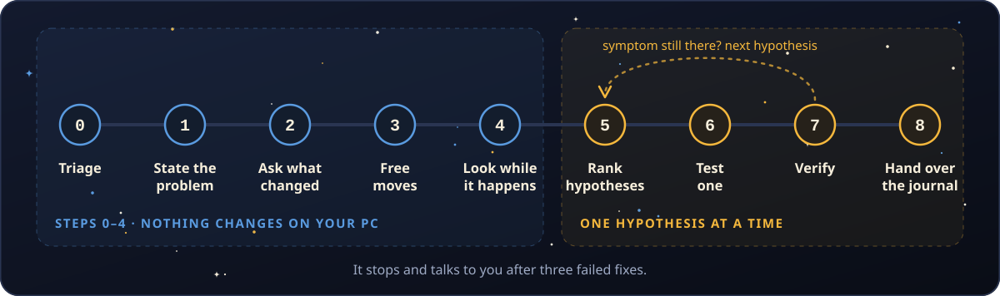

<p align="center">
  
</p>

<p align="center">
  
</p>

<p align="center">
  <a href="https://github.com/agencekoeki/koeki-it-support/releases/latest"></a>
  <a href="LICENSE"></a>
  <a href="https://agentskills.io"></a>
  
  
  
</p>

<p align="center">
  <a href="#installation"><b>Install</b></a> ·
  <a href="#what-it-does">How it works</a> ·
  <a href="#example">Example</a> ·
  <a href="koeki-it-support/SKILL.md">Read the skill</a> ·
  <a href="README.fr.md">Version française</a>
</p>

# koeki-it-support

**IT support that makes house calls.** An Agent Skill that turns Claude into a careful technician for your own Windows 10 or 11 PC. It reasons like a seasoned field technician, asks your permission before every change, and leaves a written journal of everything it did.

> **Status: v0.1.** Built from the troubleshooting literature and Microsoft documentation. Not yet validated by field technicians. If you are one, [we need your cases](CONTRIBUTING.md).

<p align="center">
  
</p>

## What it will say to you

Yes, it will ask whether you have restarted it. A real **Restart**, not **Shut down**: with Fast Startup, Windows doesn't treat them as the same thing. What sets it apart is what comes after the restart.

| You | It |
|---|---|
| "Have I tried restarting it? Obviously." | "Shut down, or Restart? Let's do a real Restart. I'll wait." |
| "Just fix everything in one go." | "No. One change at a time, or we'll never know which one worked." |
| "I found a free PC optimizer." | "Please put it down." Then the tool already built into Windows that does the job. |
| "Defender is in the way. Switch it off." | "No." One sentence on why, and a safe alternative. |
| "A pop-up says to call Microsoft on this number." | "That isn't Microsoft. Their messages never contain a phone number." |
| "It feels faster now, I think." | "We don't do 'I think'. Restart, measure again, and then it goes in the journal." |

These lines are illustrative, not transcripts: the skill is more polite, and exactly as stubborn. The behaviour behind each one is written down in [the skill](koeki-it-support/SKILL.md).

## Why this exists

A desktop PC showed "Connected", yet nothing would load. The laptop next to it worked fine.

Three causes were stacked on top of each other:

1. **A manual IP address with no gateway.** The PC had nowhere to send its traffic.
2. **The web filter of a third-party security suite.** It blocked DNS and web traffic but let ping through, so the network looked half alive.
3. **A self-hosted DNS server that had failed months earlier.** Nobody had noticed: every device quietly fell back to the router's IPv6 DNS, which masked the outage.

Fixing the gateway didn't bring the web back. Removing the filter did, but only querying each DNS server one by one revealed the third, silent failure. Doctors call this Hickam's dictum: a patient can have several diseases at once. A tool that stops at the first plausible cause would have declared victory too early. A script that "resets everything" would have erased the evidence.

That is the job this skill is built for: look before touching, change one thing at a time, re-measure after every fix, and keep going until the original symptom is really gone.

What sets it apart:

- **It thinks, it doesn't just run commands.** It reasons like a technician, drawing on Agans' debugging rules, Google's SRE troubleshooting chapter, Brendan Gregg's USE method, Kepner-Tregoe's "is / is not" analysis and Mark Russinovich's case files.
- **It asks before every change**, on four levels of risk.
- **It creates a restore point before the first change**, checks that it really exists, and keeps a journal.
- **It refuses risky practices**: registry cleaners, debloat scripts, switching Microsoft Defender off.
- **It speaks your language**, in plain words, to people who aren't technical.

## What it does

The skill first names the mission, because success is measured differently:

| Mission | Typical situation | Success means |
|---|---|---|
| **Fix** | Something that used to work broke | Symptom gone, verified after a restart |
| **Tune** | A working PC feels slow | A measured gain on the two or three actions that matter to you |
| **Second life** | Old, slow or unsupported PC | A sound decision: repair, upgrade, repurpose, replace or recycle |

### The reasoning loop

<p align="center">
  
</p>

Steps 0 to 4 change nothing on your PC.

0. **Triage.** Is data at risk? Then back up first, before anything else.
1. **State the problem.** How slow, since when, on which device? What is affected, and what could be but isn't?
2. **Ask what changed** since it last worked: your story first, then the evidence (Reliability Monitor, install dates, updates).
3. **Free moves, with your yes:** a real restart, another device, a cable.
4. **Look while the symptom is happening:** a resource tour for slowness, a layer-by-layer ladder for network problems.
5. **Rank hypotheses:** likely, cheap and safe first. Common causes before exotic ones, without forgetting that several causes can stack up.
6. **Test one hypothesis at a time:** a reversible change, measured before and after, approved, logged. Undone at once if it didn't help.
7. **Verify** after a restart, under the same conditions. Never on feel.
8. **Hand over the journal:** what changed, how to undo it, what was learned.

It stops and talks to you after three failed fixes, re-measures the original symptom after the first cause is found, and hands hardware failures, BIOS problems and data recovery over to a human technician.

### Four levels of consent

<p align="center">
  
</p>

| Level | Examples | What the skill requires |
|---|---|---|
| **0. Read** | Network settings, event logs, disk health | It says what it reads and why. It never displays secrets (Wi-Fi keys, product keys, BitLocker keys). |
| **1. Reversible, no admin** | Disable a startup app, pause cloud sync | Your explicit yes for that action, a restore point before the first change, a journal line. |
| **2. System** | Uninstall a program, change a driver or a service, clean boot | A verified restore point, the exact command shown and explained, your yes. You run it as administrator: the skill never elevates itself. |
| **3. Heavy** | Network reset, System Restore, PC reset, BIOS, hardware | A verified backup, your BitLocker recovery key in hand, mains power, the offer of a human technician, and your yes at each step. |

Consent is given per action, never per batch. Ask it to "just do everything at once" and it will explain why it won't: when several changes go in together, nobody can tell which one helped or broke something.

### What it refuses

It won't pipe a remote script into PowerShell, install registry cleaners, "PC optimizers" or third-party driver updaters, apply debloat scripts or tweak packs, or switch off Windows Update, Microsoft Defender, the firewall or UAC. It won't add an antivirus exclusion because a tool asks for one, run heavy disk operations on a failing disk before a backup, or open remote access for someone you didn't contact yourself. Each time, it explains why in one sentence and offers the safe, built-in alternative. It also recognizes tech-support scams: Microsoft's messages never contain a phone number.

The whole skill is one Markdown file, with no scripts. Read it before you install it, as you would any skill: [koeki-it-support/SKILL.md](koeki-it-support/SKILL.md).

## Installation

### As a plugin (stays up to date)

This repository is also a plugin marketplace: Claude can follow it, so you don't download a zip again for each version.

**Claude (claude.ai and the desktop app)**

1. Go to **Customize > Plugins**, then **Add > Add marketplace > Add from a repository**.
2. Enter `agencekoeki/koeki-it-support`, leave **Sync automatically** on, and select **Sync**.
3. Select **Add** next to **Koeki IT Support**.

With **Sync automatically** on, the plugin is kept up to date when this repository changes. The plugin is saved to your account, so it is also available in Cowork and Claude Code.

Source: [Plugins](https://claude.com/docs/plugins/overview), Claude documentation.

**Claude Code**

```
/plugin marketplace add agencekoeki/koeki-it-support
/plugin install koeki-it-support@koeki
```

Then describe your problem, or type `/koeki-it-support:koeki-it-support`.

The plugin follows this repository's commits. To update it, open `/plugin`, go to **Marketplaces**, select **koeki**, then **Update marketplace**. On the same screen, **Enable auto-update** makes Claude Code do it for you (it is off by default for marketplaces that aren't Anthropic's).

Source: [Install and manage plugins](https://code.claude.com/docs/en/plugins/install), Claude Code documentation.

### As a skill, from the zip (claude.ai and the desktop app)

Download `koeki-it-support.zip` from the [latest release](https://github.com/agencekoeki/koeki-it-support/releases/latest). It contains the `koeki-it-support/` folder with its `SKILL.md`.

1. Check that code execution is on: **Settings > Capabilities > Code execution and file creation**. On Team and Enterprise plans, an organization owner controls this.
2. Go to **Customize > Skills**, click **+**, then **Create skill > Upload a skill**.
3. Choose `koeki-it-support.zip`, then turn the skill on.

Custom skills are available on the Free, Pro, Max, Team and Enterprise plans. In a regular chat, Claude has no access to your PC: it hands you one command at a time, tells you where to run it, and reads the output you paste back.

Source: [Use skills in Claude](https://support.claude.com/en/articles/12512180-use-skills-in-claude), Claude Help Center.

### As a skill, by hand (Claude Code)

Copy the `koeki-it-support` folder (the one that contains `SKILL.md`) into `~/.claude/skills/` to use it in all your projects, or into a project's `.claude/skills/` folder.

macOS, Linux or Git Bash:

```bash
git clone https://github.com/agencekoeki/koeki-it-support.git
mkdir -p ~/.claude/skills
cp -r koeki-it-support/koeki-it-support ~/.claude/skills/
```

Windows PowerShell:

```powershell
git clone https://github.com/agencekoeki/koeki-it-support.git
New-Item -ItemType Directory -Force "$HOME\.claude\skills" | Out-Null
Copy-Item -Recurse .\koeki-it-support\koeki-it-support "$HOME\.claude\skills\"
```

Claude Code picks the skill up without a restart. If the skills folder didn't exist when your session started, run `/reload-skills`. Then describe your problem, or type `/koeki-it-support`. When Claude Code runs on the Windows PC itself, the skill runs read-only commands on its own and hands you anything that needs administrator rights.

Source: [Extend Claude with skills](https://code.claude.com/docs/en/skills), Claude Code documentation.

### Other tools

koeki-it-support follows the open [Agent Skills](https://agentskills.io) format. Many agents support it: see [agentskills.io](https://agentskills.io) for the list of compatible tools and their installation instructions, and the [specification](https://agentskills.io/specification).

## Example

An illustrative exchange, shortened. The program name is invented.

> **You:** My PC takes three minutes to boot since last week.
>
> **Claude:** Let's find what changed. Is it three minutes until the sign-in screen, or until you can actually work? Did you install or update anything last week? Meanwhile, I'd like to read Windows' own boot log. It changes nothing. Please run this command in Windows PowerShell opened as administrator, and paste the result. *(a read-only command)*
>
> **You:** *(pastes the output)*
>
> **Claude:** Your boots went from about 40 seconds to about 170 since Tuesday, and Windows itself blames a vendor update helper installed that day for about 90 seconds of delay. That's my first hypothesis; nothing else is ruled out yet. Before any change, let's create a restore point and check that it really exists.
>
> **Claude:** Next step, if you agree: disable "VendorUpdateHelper" in Task Manager > Startup apps. It's reversible and uninstalls nothing. May I walk you through it?
>
> **You:** Yes.
>
> **Claude:** Done. Now please do a real **Restart** (not Shut down), then run the same command again.
>
> **You:** *(42 seconds)*
>
> **Claude:** Back to normal, measured after a real restart. Here is your journal.

| Time | Change | Measured effect | How to undo |
|---|---|---|---|
| 10:42 | Restore point "Before IT support changes", checked in the list | — | — |
| 10:47 | Disabled "VendorUpdateHelper" in Task Manager > Startup apps | Boot from about 170 s to 42 s, after a real restart | Re-enable it in Task Manager > Startup apps |

## Evaluation

[evals/scenarios.md](evals/scenarios.md) holds eleven test scenarios, starting with the story above. [evals/rubric.md](evals/rubric.md) holds the fixed scoring grid and the pressure tests (a hurried, annoyed or insistent person). No scored results are published yet.

## Limitations

- **Version 0.1.** Grounded in the literature and Microsoft documentation, not yet reviewed by field technicians. Its case patterns are starting points, not verdicts.
- **Windows 10 and 11 only.** Not for servers, Macs or troubleshooting Linux.
- **It needs hands on the PC:** either a shell on that PC (for example, Claude Code running on it) or a copy-paste conversation in which you run each command. Administrator commands are always run by you.
- **Not field-tested.** Scenarios exist; real-world results don't yet.
- **Not a repair shop.** Failing hardware, warranty cases, BIOS problems, crash-dump analysis and data recovery belong with a human technician. The skill tells you when.
- **You stay in charge.** An AI can be wrong. The skill makes every change consented, reversible and logged, but it comes with no warranty (see the [license](LICENSE)).

## Second life and carbon, honestly

When a PC is old, slow or can't run Windows 11, the skill walks down a ladder and stops at the first rung that fits: repair the software causes, upgrade only the measured bottleneck (on a hard drive, an SSD is the classic one), repurpose, replace, and finally recycle. Windows 10 support ended on 14 October 2025, and consumer Extended Security Updates run until 12 October 2027, with conditions that vary by region ([Microsoft](https://www.microsoft.com/en-us/windows/extended-security-updates)).

Why bother? Because of where a computer's carbon footprint actually comes from:

- **In France, manufacturing accounts for about 80 to 85% of an end-user device's footprint** ([ADEME-Arcep](https://www.arcep.fr/uploads/tx_gspublication/etude-numerique-environnement-ademe-arcep-note-synthese_janv2022.pdf)).
- **Slimming a PC's software saves roughly 0.4 to 3 kg CO2e a year** on the French grid.
- **Keeping a laptop six years instead of four avoids about 15 kg CO2e a year** ([Impact CO2](https://impactco2.fr/outils/numerique/ordinateurportable)).
- **On a more carbon-intensive grid, consumption matters more.** A heavily used desktop that wastes 20 W can emit an extra 12 to 27 kg CO2e a year on EU-average to world-average electricity.
- **The gain only exists if the tune-up actually delays a purchase.** No study yet proves that tuning up a PC extends its life.

So the skill makes no green promises. What it says is: "Slimming your PC saves a little electricity. The real win is not having to buy another one."

<details>
<summary>How these numbers were computed</summary>

- **80 to 85%:** manufacturing's share of the carbon footprint of end-user devices, computed from the detailed tables of the ADEME-Arcep study ([volume 2](https://www.arcep.fr/uploads/tx_gspublication/etude-numerique-environnement-ademe-arcep-volet02_janv2022.pdf)). The summary note gives 78% for digital as a whole, and devices account for 79% of the total.
- **15 kg a year:** a laptop's manufacturing and end of life weigh about 185 kg CO2e (Impact CO2). Spread over four years, that is about 46 kg a year; over six years, about 31 kg.
- **0.4 to 3 kg a year:** for example, 5 W saved over 1,500 hours of use a year, up to 20 W over 3,000 hours, with French electricity at about 0.052 kg CO2e/kWh ([ADEME, Base Empreinte](https://data.ademe.fr/datasets/base-carboner)).
- **12 to 27 kg a year:** 20 W over 3,000 hours is 60 kWh, at about 0.21 (EU) to 0.46 (world) kg CO2e/kWh ([Ember, via Our World in Data](https://ourworldindata.org/grapher/carbon-intensity-electricity)).

</details>

## References

Method:

- David J. Agans, *Debugging: The 9 Indispensable Rules*: [debuggingrules.com](https://debuggingrules.com/)
- Google, *Site Reliability Engineering*, "Effective Troubleshooting": [sre.google](https://sre.google/sre-book/effective-troubleshooting/)
- Brendan Gregg, "The USE Method": [brendangregg.com](https://www.brendangregg.com/usemethod.html)
- Brendan Gregg, "Performance Analysis Methodology": [brendangregg.com](https://www.brendangregg.com/methodology.html)
- Kepner-Tregoe, "Enhanced troubleshooting: KT and Six Sigma": [kepner-tregoe.com](https://kepner-tregoe.com/blogs/enhanced-troubleshooting-kt-and-six-sigma/)
- Mark Russinovich, "The Case of the Slow Project File Opens": [learn.microsoft.com](https://learn.microsoft.com/en-us/archive/blogs/markrussinovich/the-case-of-the-slow-project-file-opens)
- Gary Klein, Critical Decision Method: [gary-klein.com](https://www.gary-klein.com/cdm)

Windows:

- Microsoft, "Tips to improve PC performance in Windows": [support.microsoft.com](https://support.microsoft.com/en-us/windows/tips-to-improve-pc-performance-in-windows-b3b3ef5b-5953-fb6a-2528-4bbed82fba96)
- Microsoft, "How to perform a clean boot in Windows": [support.microsoft.com](https://support.microsoft.com/help/929135)
- Microsoft, "Microsoft Defender Antivirus compatibility": [learn.microsoft.com](https://learn.microsoft.com/en-us/defender-endpoint/microsoft-defender-antivirus-compatibility)
- Microsoft Security Blog, "Think before you ClickFix" (2025): [microsoft.com](https://www.microsoft.com/en-us/security/blog/2025/08/21/think-before-you-clickfix-analyzing-the-clickfix-social-engineering-technique/)
- Microsoft, Windows 10 Extended Security Updates: [microsoft.com](https://www.microsoft.com/en-us/windows/extended-security-updates)

Carbon:

- ADEME-Arcep, digital environmental footprint in France, summary note (January 2022, in French): [arcep.fr](https://www.arcep.fr/uploads/tx_gspublication/etude-numerique-environnement-ademe-arcep-note-synthese_janv2022.pdf)
- Impact CO2 (ADEME), laptop: [impactco2.fr](https://impactco2.fr/outils/numerique/ordinateurportable)

Format:

- Agent Skills specification: [agentskills.io](https://agentskills.io/specification)

### Related work

No code was reused from these projects. They are the closest prior work we found, and some ideas echo them.

- [windows-ops](https://github.com/0xdarkmatter/claude-mods) (in 0xdarkmatter/claude-mods): Windows workstation diagnostics for Claude Code, with a solid diagnostic ladder. MIT.
- [windows-optimize](https://github.com/prabhatp75/windows-optimize) (prabhatp75): a safe, reversible Windows performance skill, with a clear consent and rollback model. MIT.
- [systematic-debugging](https://github.com/obra/superpowers) (in obra/superpowers): a model of a "thinking" skill, for code. The rule "three failed fixes: stop and talk" echoes it. MIT.

## Contributing

We are mostly looking for field technicians willing to share real cases. See [CONTRIBUTING.md](CONTRIBUTING.md). Any change to the skill goes through an issue or a reviewed pull request.

## Credits

Made by [KOEKI SAS](https://www.koeki.fr), an AI and SEO consultancy in France. Written by Sébastien Grillot.

The method stands on the work of David Agans, Google's SRE authors, Brendan Gregg, Kepner-Tregoe, Mark Russinovich and Gary Klein. Any mistakes are ours.

The tone owes something to a certain British IT department, based in a basement. The method doesn't.

## License

[MIT](LICENSE). Copyright (c) 2026 KOEKI SAS.

Independent project, not affiliated with or endorsed by Anthropic or Microsoft. Windows and Microsoft Defender are trademarks of Microsoft.
